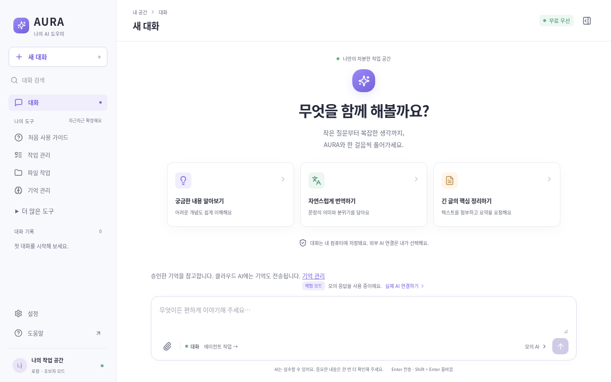

# AURA Agent

한국어로 편하게 대화하는 로컬 AI 도우미. **M8 통합 QA 버전**입니다. 실제 공급자 어댑터, 명시적 모의 공급자, 승인 기반 복합 작업을 제공합니다. Windows 설치 패키지는 준비 중입니다.



## 실행

Node.js **24 이상**에서:

```sh
npm ci
npm run build
npm start
```

[http://127.0.0.1:4317](http://127.0.0.1:4317)을 엽니다. 개발 모드는 `npm run dev`입니다. 서버는 localhost에만 바인딩합니다. `AURA_PORT`, `AURA_DATA_DIR`로 포트와 데이터 경로를 지정할 수 있습니다.

## 지금 사용할 수 있는 기능

- 5단계 한국어 초기 설정·다시 보기, 라이트/다크/시스템 테마, 반응형 화면
- 처음 사용 가이드·기능 검색·권한/오류 해결 안내, 초보자 추가 메뉴 접기, 모바일 키보드 탐색
- 내장 MCP의 쉬운 파일/검색 입력과 연결 오류 후 입력 복구
- Gemini / Groq / 로컬 Ollama 어댑터, 실제 연결 테스트, 모델 목록 확인
- 오프라인 체험용 **모의 AI**: 실제 AI 응답과 명확히 구분
- 스트리밍, 중단, 대화 저장/검색/이름변경/삭제/편집/재생성/JSON 내보내기
- 텍스트 파일 첨부, Markdown과 코드 복사, 사용량 추정
- 외부 전송 기본 차단, 동의 확인, 모델 자동 유료 전환 없음
- Linux: 허용한 폴더의 텍스트 목록·읽기·생성·수정·삭제·승인 후 복구
- 변경 전후 미리보기, 10분 유효 1회 승인, 권한 철회, 재시작 후 권한 해제, 실행 기록
- 공개 HTTPS 페이지의 본문 읽기와 읽기 화면 캡처 (로그인·클릭·폼 입력 제외)
- 작업 관리: 목표 → 도구 선택 → 개별 승인 → 파일 결과 검증, 일시중지·재시작 후 재개
- API 키 없이 실제 파일 목록·읽기·보고서 저장을 체험하는 명시적 모의 복합 작업
- 기억 관리: 초안·승인·검색·수정·삭제·내보내기, 출처를 추적하는 대화 요약
- 스킬 관리: 완료 작업의 절차 저장, 버전 검토·승인 후 새 작업에서 재사용
- MCP: 내장 프로젝트 읽기 서버의 실제 연결, 도구 발견·권한·입력 승인·호출·결과 기록
- 미리 설치한 GitHub/Serena/Repomix CLI 연결 관리 (실제 외부 서비스 연결은 미검증)

API 키는 서버 메모리에만 저장합니다. 서버를 재시작하면 다시 입력해야 합니다. **무료 계정 여부는 공급자 콘솔에서 직접 확인해야 하며, 앱이 유료 계정의 실제 과금을 차단하지는 못합니다.**

Groq 키는 제공되었지만 개발 환경의 네트워크 정책이 api.groq.com을 허용하지 않아 전송하지 않았습니다. Ollama 인스턴스도 없어 개발 검증은 모의 공급자 및 프로토콜 fixture로 진행했습니다. 실제 서비스 연결 성공을 주장하지 않습니다.

## 검증

```sh
npx playwright install chromium
npm run check
npm run test:e2e
```

E2E는 시스템 Chromium이 있으면 사용하고, 없으면 Playwright 브라우저를 사용합니다. `CHROMIUM_PATH`로 실행 경로를 지정할 수 있습니다. 각 테스트는 별도 앱 프로세스와 임시 SQLite를 사용합니다. 결과는 `playwright-report/index.html`에서 확인합니다. 빌드/보고서 경로를 공유하므로 E2E 명령은 순차 실행합니다.

## 문서

- [사용 설명서](docs/USER_GUIDE.md)
- [처음 설정](docs/ONBOARDING_GUIDE.md)
- [구현 단계와 후속 조건](docs/CODEX_PHASES.md)
- [조사 근거·라이선스](docs/RESEARCH_REFERENCES.md)
- [시스템 구조](docs/SYSTEM_ARCHITECTURE.md) · [보안 및 한계](docs/SECURITY_DESIGN.md)
- [M7 사용성 검수와 남은 사용자 실험](docs/M7_UX_REVIEW.md)
- [M8 통합 QA 결과와 재실행 방법](docs/M8_QA_REPORT.md)
- [테스트와 시각 QA](docs/TEST_QA_PLAN.md) · [구현 기록](docs/IMPLEMENTATION_LOG.md)

웹 읽기에는 Chromium이 필요합니다 (`npx playwright install chromium` 또는 `CHROMIUM_PATH`). Windows/macOS 파일 도구, 동적 브라우저 제어, 터미널, MCP 자동 계획 연동, 자동 백그라운드 요약은 준비 중입니다. 파일 원본은 숨김 복구 폴더에도 보관하며 자동 정리하지 않습니다. 자세한 범위와 한계는 [도구 설계](docs/TOOL_MCP_DESIGN.md)를 참고하세요.
